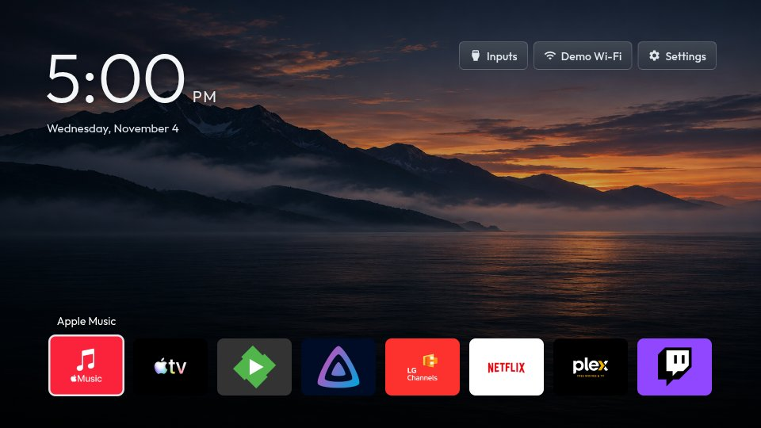

# Atmosphere theme

A quiet landscape and horizontal app dock for [Clean Your TV on LG webOS](https://github.com/Razdva122/clean-your-tv-lg-webos). The original Atmosphere wallpaper, cool white clock and dark blue panels leave the scenery prominent. Home navigation, app management and recovery remain supplied by the launcher.



This is the public standalone theme source and versioned distribution. Community catalogue inclusion is submitted separately for maintainer review. It is compatible with Home's theme engine **1.7.0 or newer** and requires `ribbon-layout-v1` support. It is not an Android TV theme.

## Build

Use Node.js 22 or newer, Git and a trusted checkout of Clean Your TV webOS **v1.7.1** or a descendant. Install that checkout's locked build dependencies once with `npm ci --ignore-scripts --no-audit --no-fund`. This theme adds no dependencies.

From this repository, after committing your edits:

```sh
npm run build -- --runtime ../cleanyourtv-webos
```

The build checks runtime Git ancestry, rejects uncommitted source changes, requires every consumed input to match the actual source commit, rejects escaping paths and symlinks, and verifies the compiled package with the launcher's own theme verifier. Ignored or untracked assets cannot enter the package. Rebuilding the same source with the same runtime produces identical bytes. Use a trusted runtime: the build executes its compiler on this computer.

Generated `dist/` is ignored by Git. It contains:

- `cytv-theme.json`, `rules.json`, images and license/credits documents: the theme distribution.
- `atmosphere.theme.json`: the local-transfer envelope accepted by the launcher's theme receiver.

The build keeps the previous output if validation fails. It does not pair with a TV, install anything, change TV state or publish files.

## Install version 1.0.0

On Home, open **Settings → Themes → Add by ID**, enter this [fixed theme package link](https://raw.githubusercontent.com/luigy-lemon/atmosphere-theme/15135d75807e6e4fe595bb0975dd336ae826fdeb/releases/1.0.0/cytv-theme.json), choose **Load**, then select Atmosphere:

```text
https://raw.githubusercontent.com/luigy-lemon/atmosphere-theme/15135d75807e6e4fe595bb0975dd336ae826fdeb/releases/1.0.0/cytv-theme.json
```

Home downloads and verifies the theme data. Select **Classic** in Themes to restore the launcher's original appearance. Theme installation does not change Home routing or remote controls.

[Version 1.0.0](https://github.com/luigy-lemon/atmosphere-theme/releases/tag/v1.0.0) also provides the compiled `atmosphere.theme.json` envelope for local-transfer tooling. Use the upstream [theme guide](https://github.com/Razdva122/clean-your-tv-lg-webos/blob/main/docs/THEMES.md) for **Receive from computer** and current controls.

This fixed distribution was built from source commit [`9b876f1`](https://github.com/luigy-lemon/atmosphere-theme/tree/9b876f11dc75bbb8393160bfc4b5444ae3ad7cf6). The descriptor SHA-256 is `fc0909d347f09db0cb9bd55e834cacdd4be6b319ff2b67866933ceab5c38a5d1`. Its source revision and distribution revision intentionally differ: generated files were committed after the source build.

Community catalogue inclusion requires maintainer review. Until inclusion, install directly using the fixed package link above. The preview uses example apps and simulated TV functions; it contains no personal TV screenshot or device configuration.

## Checks

```sh
CYTV_RUNTIME=../cleanyourtv-webos npm test
```

The self-check uses an isolated copy of the committed source to test deterministic output, package verification, committed provenance, ignored-input and dirty-source rejection, and path/symlink rejection. It never contacts a TV. The preview uses example apps and simulated TV functions; it does not establish compatibility of every device or firmware.

See [LICENSE.txt](LICENSE.txt) and [CREDITS.txt](CREDITS.txt) for styling, wallpaper and preview attribution.
